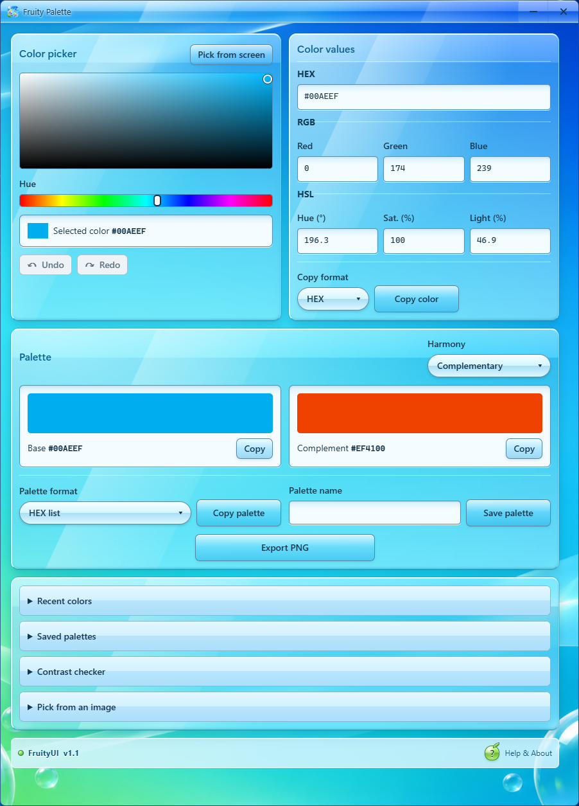

# FruityPalette v1.0

An offline desktop color picker and palette builder with **Frutiger Aero** styling.

The idea is simple: small tools for familiar tasks, brought to life with
**Frutiger Aero**. FruityPalette brings color picking, palette building, and
contrast checks together in a desktop app with glossy glass and watery blues.

  

  <a href="https://github.com/kapsaloco/FruityPalette/releases">Downloads &amp; Releases</a>

Pick a color, explore matching shades, and copy or export the result. Your
images and saved palettes stay on your device.

## Features

- Pick colors visually or enter HEX, RGB, and HSL values.
- Sample colors from the Windows desktop or a local PNG, JPEG, or WebP image.
- Generate complementary, analogous, triadic, split-complementary, and monochromatic palettes.
- Copy a single color or the full palette as a HEX list or CSS variables. Export palettes as PNG images.
- Check text contrast between two palette colors with a live preview and WCAG AA/AAA ratings.
- Revisit recent colors and undo or redo changes.
- Save, rename, and delete palettes locally. Back up and restore your library as JSON.

## Usage

1. Choose a base color with the picker, enter a color value, or sample a color from the screen or an image.
2. Select a harmony to build your palette.
3. Copy a swatch or the full palette, or select **Export PNG**.
4. Give the palette a name and select **Save palette** to reopen it later.

While screen picking on Windows, press **Space** or **Enter** to sample, or
**Backspace** or **Esc** to cancel. Find library backup and restore under
**Saved palettes**.

## Privacy

FruityPalette works locally without an account or network service. Images and
screen samples are processed on your device. Saved palettes stay in local app
storage, and backups and exports are written where you choose.

The Windows app uses the Microsoft Edge WebView2 runtime.

## FruityUI

FruityPalette uses FruityUI 1.1. The [versioned showcase](showcase/README.md)
documents the reusable additions, changelog, and archived 1.0 examples.

## License

FruityPalette is licensed under the [MIT License](LICENSE). FruityUI is also
distributed under the [MIT License](src/styles/fruity/LICENSE). Third-party
dependencies retain their own licenses.

